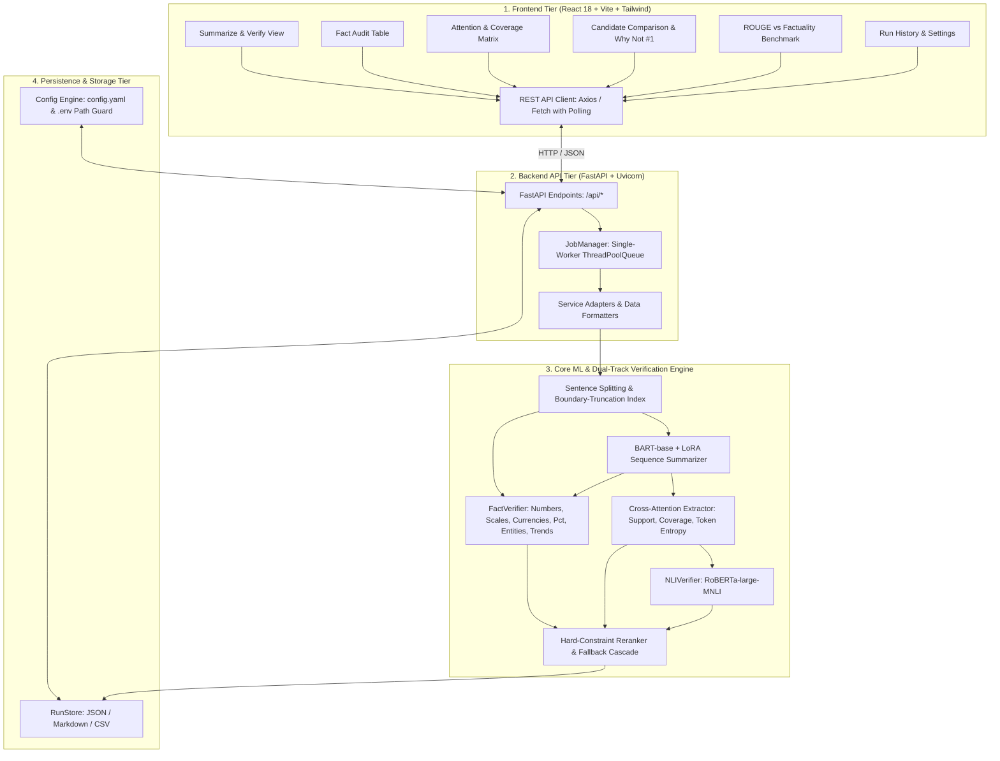

# EquiSumm — System Architecture & Design Specification

## 1. Executive Summary

**EquiSumm** is a verified document summarization and decision-support platform designed for high-stakes legal, financial, and legislative texts. 

Standard sequence-to-sequence summarization models often generate fluent hallucinations, alter critical quantities (e.g., confusing "million" with "billion"), or invert direction indicators ("revenue fell" vs. "revenue rose"). Traditional lexical overlap metrics like ROUGE are oblivious to these factual corruptions. EquiSumm resolves this by combining fine-tuned abstractive generation with teacher-forced cross-attention extraction, attention-guided Natural Language Inference (NLI), rule-based fact verification, and a hard-constraint reranking cascade.

The project features a decoupled **React 18 (Vite + Tailwind CSS)** client and a high-performance **FastAPI** backend with asynchronous job serialization, built atop an optimized **PyTorch / Hugging Face** inference core.

---

## 2. High-Level System Architecture



---

## 3. Core Data Contracts

The architecture is built on strictly-typed, frozen dataclasses defined in `equisumm_mvp/contracts.py`:

```
SourceTokenIndex
├── input_ids: list[int]             # Model token sequence (including special tokens)
├── token_sentence: list[int]        # Token-to-source-sentence index mapping (-1 for special)
├── n_sentences: int                 # Source sentences retained after truncation
└── n_truncated_sentences: int       # Trailing sentences omitted due to budget

Candidate
├── cand_id: int                     # Beam sequence identifier (0..N-1)
├── text: str                        # Decoded clean summary text
├── token_ids: list[int]             # Decoder sequence tokens
└── seq_logprob: float               # Length-normalized beam score

CandidateAttention
├── cand_id: int
├── summary_sentences: list[str]     # Individual summary sentences
├── support: list[list[float]]       # [n_sum_sent][n_src_sent] cross-attention matrix
├── token_entropy: list[float]       # Normalized entropy (0..1) across content tokens
└── source_coverage: list[float]     # [n_src_sent] attention coverage distribution

NLIResult
├── summary_sent_idx: int            # Index of target summary sentence
├── premise_sent_idxs: list[int]     # Source sentence premises selected by attention
├── entailment: float                # Entailment probability (0..1)
├── neutral: float                   # Neutral probability (0..1)
├── contradiction: float             # Contradiction probability (0..1)
└── label: str                       # 'entailment' | 'neutral' | 'contradiction'

FactReport
├── entity_precision: float          # Ratio of verified summary entities found in source
├── numeric_precision: float         # Ratio of verified numbers/scales matched to source
├── n_entities: int                  # Total entities extracted
├── n_numbers: int                   # Total numbers extracted
└── issues: list[FactIssue]          # Identified scale, direction, currency, or entity conflicts

CandidateReport
├── cand_id: int
├── nli: list[NLIResult]
├── facts: FactReport
└── flagged_sentences(threshold)    # Union of low-entailment and fact-issue sentence indices
```

---

## 4. Pipeline Execution Stages

### Stage 1: Boundary-Aware Source Indexing
`tokenization.build_source_index()` calculates token offset mappings for each sentence. Rather than arbitrarily cutting tokens mid-sentence, it enforces strict sentence-boundary truncation within the model budget (`max_source_tokens=1024`). The number of omitted trailing sentences (`n_truncated_sentences`) is explicitly tracked and surfaced as a warning.

### Stage 2: Abstractive Generation
`HFSeq2SeqSummarizer` uses `facebook/bart-base` fine-tuned with a LoRA adapter ($r=16, \alpha=32$). Diverse beam search parameters ($num\_beams \ge 4$, $no\_repeat\_ngram\_size=3$, length penalty $1.0$) generate multiple candidate summaries.

### Stage 3: Teacher-Forced Cross-Attention Extraction
`CrossAttentionExtractor` passes generated candidates back through the decoder in teacher-forced mode (`use_cache=False, output_attentions=True`).
- Cross-attention tensors from decoder layers are averaged across attention heads.
- Token-level cross-attentions are projected onto the source sentence basis $M \in \mathbb{R}^{T \times S}$.
- Produces the sentence support matrix, content token entropy, and source document coverage.

### Stage 4: Attention-Guided Premise Selection & NLI
`NLIVerifier` sorts source sentences by cross-attention support weight for each summary sentence, selecting the top-$k$ premises ($k=3$). `roberta-large-mnli` evaluates hypothesis entailment against these premises.

### Stage 5: Rule-Based Fact Verification
`FactVerifier` scans summary and source sentences with regex-based numeric and named entity extractors:
- **Scale Mismatch**: Detects identical base digits with mismatched scale multipliers (e.g. `$1.2 million` vs `$1.2 billion`).
- **Direction Conflict**: Identifies contradictory trend indicators (`rose`, `grew` vs `fell`, `dropped`) associated with the same figures.
- **Currency & Percent Incompatibilities**: Verifies symbols (`$`, `€`, `£`, `₹`) and percentage notations.
- **Entity Grounding**: Verifies proper nouns and corporate entities against source mentions.

### Stage 6: Hard-Constraint Reranker & Fallback Cascade
The reranker operates in two phases:
1. **Hard Constraints**: A candidate is feasible **if and only if** `n_fact_issues == 0` and all sentences satisfy `entailment >= threshold`.
2. **Soft Scoring**: Feasible candidates are ranked by a composite quality score:
   $$\text{Score} = w_1 \cdot \text{NormLogProb} + w_2 \cdot \text{EntailmentMean} + w_3 \cdot \text{NumPrec} + w_4 \cdot \text{EntPrec} + w_5 \cdot (1 - \text{MeanEntropy})$$
3. **Fallback State Machine**:
   - `ACCEPT`: Highest-scoring candidate passing all hard constraints.
   - `ACCEPT_PRUNED`: When all candidates fail hard constraints, the top candidate's flagged sentences are stripped, provided $\ge 1$ verified sentence remains.
   - `EXTRACTIVE_FALLBACK`: When pruning leaves zero sentences, the top-$k$ source sentences with the highest cross-attention coverage are extracted.
   - `ESCALATE`: If source content is invalid or ungrounded, routes the document to human review.

---

## 5. Backend Architecture & Job Management (FastAPI)

The backend (`backend/`) acts as the orchestration layer between web clients and the core ML pipeline:

### 1. Serialized Background Job Execution (`JobManager`)
Deep learning inference (BART generation, cross-attention, RoBERTa NLI) is compute- and VRAM-heavy. To prevent GPU memory exhaustion, server freezing, and race conditions:
- A single-worker `ThreadPoolExecutor(max_workers=1)` processes ML tasks sequentially.
- Jobs are assigned unique IDs, returning immediately to the client with `status: "queued"`.
- Clients poll `/api/jobs/{id}` at 1-second intervals for real-time progress updates and messages (`"Summarizing"`, `"Verifying facts"`, `"Complete"`).

### 2. Process-Wide Singleton Model Caching
`EquiSummPipeline` models are instantiated once in memory via singleton services (`get_pipeline()`). Weights remain memory-resident across requests, eliminating the 10–20 second overhead of reloading models per request.

### 3. REST API Surface

| Endpoint | Method | Purpose |
|---|---|---|
| `/api/health` | `GET` | Health status and queued/running job counts |
| `/api/samples` | `GET` | List pre-packaged sample documents (earnings, contract, bill, memo) |
| `/api/samples/{id}` | `GET` | Fetch specific sample document text and domain |
| `/api/jobs` | `POST` | Submit a text summarization & verification job |
| `/api/jobs/upload` | `POST` | Upload `.txt` or `.pdf` file to trigger verification job |
| `/api/jobs/{id}` | `GET` | Poll status, percentage progress, message, and completed run result |
| `/api/runs` | `GET` | List all persisted runs from disk |
| `/api/runs/{id}` | `GET` | Retrieve detailed run data (candidates, attentions, NLI, facts) |
| `/api/runs/{id}` | `DELETE` | Remove a saved run from disk |
| `/api/runs/{id}/exports/{format}` | `GET` | Export run report in `json`, `markdown`, or `csv` format |
| `/api/runs/{id}/fact-audit` | `GET` | Retrieve side-by-side numeric/entity audit table |
| `/api/runs/{id}/embeddings` | `GET` | Retrieve 2D t-SNE projection coordinates for sentence visualization |
| `/api/evaluations` | `POST` | Queue a benchmark evaluation against a dataset |
| `/api/evaluations/upload` | `POST` | Upload custom `.jsonl` benchmark dataset for evaluation |
| `/api/system` | `GET` | System telemetry (PyTorch device, VRAM allocation, config settings) |
| `/api/system/flush-cache` | `POST` | Trigger GPU VRAM cache release (`torch.cuda.empty_cache()`) |
| `/api/system/self-test` | `POST` | Run offline fact-verification test suite |
| `/api/settings` | `GET` / `PUT` | Read and write runtime parameters in `config.yaml` |

---

## 6. Frontend Architecture (React 18 + Vite)

The frontend is a modern Single Page Application (SPA) located in `frontend/`, styled with Tailwind CSS and powered by Lucide icons:

### Application Modules & Views
- **Summarize & Verify**:
  - Direct text paste or `.txt` / `.pdf` drag-and-drop upload.
  - Quick-load pre-packaged sample cases.
  - Real-time job progress bar and status indicator.
  - Sentence-level verdict highlighting:
    - 🟢 **Supported** (Entailment $\ge 0.70$ and 0 fact issues)
    - 🟡 **Weak Support** ($0.50 \le \text{Entailment} < 0.70$)
    - 🔴 **Flagged** (Contradiction / Untrusted / Fact conflict)
  - Interactive Premise Inspector: Click any summary sentence to view the exact source sentence premises selected by cross-attention with entailment score.
- **Fact Audit**:
  - Side-by-side comparison table of all numbers, scales, percentages, currencies, and entities between summary and source.
  - Filterable by verification status: *Verified*, *Scale Mismatch*, *Numeric Unsupported*, *Currency Mismatch*, *Direction Conflict*, *Entity Unsupported*.
- **Attention Explorer**:
  - Cross-attention matrix showing source-to-summary sentence attribution weights.
  - Source coverage distribution chart and token-level entropy metrics.
- **Compare Candidates**:
  - Beam candidate comparison grid showing log probabilities, NLI entailment means, entity/numeric precision, and composite soft scores.
  - "Why Not #1?" explanation detailing why the primary beam was accepted or rejected.
- **Evaluate**:
  - Benchmark runner comparing ROUGE-1/2/L lexical metrics with NLI and factual precision.
  - Divergence report highlighting high-ROUGE / low-factuality hallucinations.
- **Sentence Projections**:
  - 2D t-SNE scatter plot mapping summary sentences against source sentence clusters.
- **Runs & Settings**:
  - Saved run history management, run deletion, and multi-format export download.
  - Live GPU VRAM allocation monitor, runtime threshold adjustments, and offline test runner.

---

## 7. Storage, Caching & Path Guard

1. **Strict Non-C: Drive Path Guard & Single-Drive Support**:
   - `assert_not_c_drive()` rejects cache, checkpoint, or evaluation paths pointing directly to `C:` to prevent primary system drive saturation.
   - For environments with only a `C:` drive, either a virtual mapped drive (`subst D: C:\path`) or setting `EQUISUMM_ALLOW_C_DRIVE=true` in `.env` is fully supported.
   - `EQUISUMM_CACHE_ROOT` defaults to workspace-local `D:/nlp/equiisum/cache` (or non-C: drive).
   - `HF_HOME`, `HF_HUB_CACHE`, and `TORCH_HOME` are routed to the configured cache root before importing Hugging Face libraries.
2. **Persistent Storage (`RunStore`)**:
   - Every completed run is saved as a structured JSON file under `cache/runs/{run_id}.json`.
   - On demand, runs can be exported as human-readable Markdown or CSV audits.
3. **Hardware & VRAM Optimization**:
   - Supports CPU execution and NVIDIA GPU execution (FP16 mode).
   - Peak GPU VRAM footprint during full pipeline inference remains under 3.5GB, fitting within 6GB VRAM targets.

---

## 8. Repository Layout

```
equiisum/
├── backend/                  # FastAPI Application
│   ├── main.py               # REST API endpoints & CORS middleware
│   ├── schemas.py            # Pydantic request/response models
│   └── services/
│       ├── adapters.py       # Bridges API to core ML & evaluation services
│       └── jobs.py           # Background JobManager & single-worker queue
├── frontend/                 # React 18 SPA (Vite + Tailwind CSS)
│   ├── index.html            # Single page entry point
│   ├── package.json          # Node dependencies & build scripts
│   ├── vite.config.js        # Vite dev & build configuration
│   └── src/
│       ├── App.jsx           # Main application view container & routing
│       ├── api.js            # Central REST API client
│       └── index.css         # Tailwind style directives
├── equisumm_mvp/             # Core Machine Learning & Verification Modules
│   ├── contracts.py          # Strict dataclass schemas
│   ├── tokenization.py       # Sentence boundary splitting & token indexing
│   ├── hf_seq2seq.py         # BART-base + LoRA seq2seq summarizer
│   ├── extractor.py          # Teacher-forced cross-attention extractor
│   ├── nli_model.py          # RoBERTa-large-MNLI premise verifier
│   └── fact_verifier.py      # Regex numeric/scale/direction/entity verifier
├── equisumm_bart_lora/       # Fine-tuned BART LoRA adapter weights & tokenizer
├── app/                      # Legacy Streamlit Application & Shared Services
│   ├── Home.py               # Legacy Streamlit entry point
│   ├── config.py             # Path guard bootstrap & settings loader
│   ├── ui_utils.py           # Styling and export helpers
│   └── services/
│       ├── pipeline.py       # 6-stage end-to-end pipeline & session model cache
│       ├── reranker.py       # Hard constraints, composite scoring, fallbacks
│       ├── evaluate.py       # ROUGE vs factuality benchmark runner
│       ├── store.py          # RunStore disk persistence & export generator
│       └── viz.py            # Plotly & t-SNE projection utilities
├── samples/                  # Sample financial, legal, and legislative documents
├── tests/                    # Pytest test suite (15 unit tests)
├── config.yaml               # System parameters & reranker weights
├── requirements.txt          # Python dependencies
├── README.md                 # Project overview and quickstart guide
└── ARCHITECTURE.md           # System design specification (this document)
```
