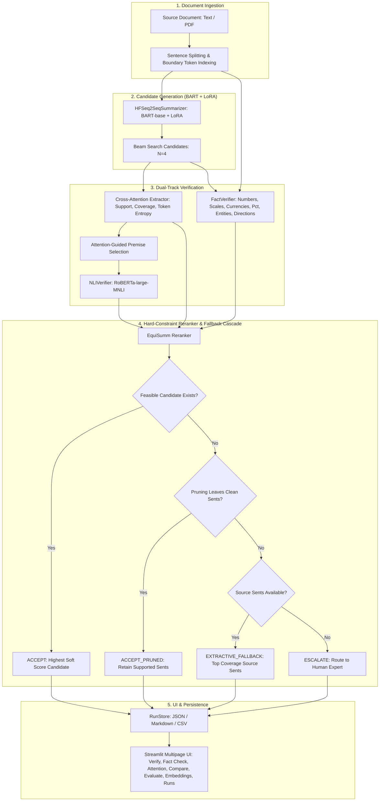

# EquiSumm — System Architecture & Design Specification

## 1. Executive Summary

**EquiSumm** is a pair-programming and decision-support platform designed to summarize high-stakes legal, financial, and legislative documents while verifying every summary sentence against source premises. 

Standard sequence-to-sequence models frequently generate fluent hallucinations, alter critical quantities (e.g., confusing "million" with "billion"), or invert business trends ("revenue fell" vs. "revenue rose"). Traditional n-gram overlap metrics like ROUGE are oblivious to these errors. EquiSumm resolves this by combining fine-tuned abstractive generation with teacher-forced cross-attention extraction, attention-guided Natural Language Inference (NLI), rule-based fact verification, and a hard-constraint reranking cascade.

---

## 2. High-Level System Architecture



---

## 3. Core Data Contracts

The architecture is built on strictly-typed, frozen dataclasses defined in `contracts.py`:

```
SourceTokenIndex
├── input_ids: list[int]             # Model token sequence (including special tokens)
├── token_sentence: list[int]        # Token-to-source-sentence index mapping (-1 for special)
├── n_sentences: int                 # Source sentences retained after truncation
└── n_truncated_sentences: int       # Trailing sentences omitted due to budget

Candidate
├── cand_id: int                     # Beam sequence identifier (0..N-1)
├── text: str                        # Decoded clean summary text
├── token_ids: list[int]             # Decoder sequence tokens
└── seq_logprob: float               # Length-normalized beam score

CandidateAttention
├── cand_id: int
├── summary_sentences: list[str]     # Individual summary sentences
├── support: list[list[float]]       # [n_sum_sent][n_src_sent] cross-attention matrix
├── token_entropy: list[float]       # Normalized entropy (0..1) across content tokens
└── source_coverage: list[float]     # [n_src_sent] attention coverage distribution

NLIResult
├── summary_sent_idx: int            # Index of target summary sentence
├── premise_sent_idxs: list[int]     # Source sentence premises selected by attention
├── entailment: float                # Entailment probability (0..1)
├── neutral: float                   # Neutral probability (0..1)
├── contradiction: float             # Contradiction probability (0..1)
└── label: str                       # 'entailment' | 'neutral' | 'contradiction'

FactReport
├── entity_precision: float          # Ratio of verified summary entities found in source
├── numeric_precision: float         # Ratio of verified numbers/scales matched to source
├── n_entities: int                  # Total entities extracted
├── n_numbers: int                   # Total numbers extracted
└── issues: list[FactIssue]          # Identified scale, direction, or entity conflicts

CandidateReport
├── cand_id: int
├── nli: list[NLIResult]
├── facts: FactReport
└── flagged_sentences(threshold)    # Union of low-entailment and fact-issue sentence indices
```

---

## 4. Pipeline Execution Stages

### Stage 1: Boundary-Aware Source Indexing
`tokenization.build_source_index()` calculates offset mappings for each sentence. Rather than arbitrarily cutting tokens mid-sentence, it enforces strict sentence-boundary truncation within the model's budget (`max_source_tokens=1024`). The number of omitted trailing sentences (`n_truncated_sentences`) is tracked and surfaced as a warning.

### Stage 2: Abstractive Generation
`HFSeq2SeqSummarizer` uses `facebook/bart-base` fine-tuned with a LoRA adapter ($r=16, \alpha=32$). Generation parameters from `equisumm_meta.json` ensure diverse beam search ($num\_beams \ge 4$, $no\_repeat\_ngram\_size=3$, length penalty $1.0$).

### Stage 3: Teacher-Forced Cross-Attention Extraction
`CrossAttentionExtractor` passes the generated candidate back through the model in teacher-forced mode (`use_cache=False, output_attentions=True`). 
- Cross-attention tensors from decoder layers are averaged across heads.
- Token-level cross-attentions are projected onto the source sentence basis $M \in \mathbb{R}^{T \times S}$.
- Produces the sentence support matrix, content token entropy, and source document coverage.

### Stage 4: Attention-Guided Premise Selection & NLI
`NLIVerifier` sorts source sentences by cross-attention support weight for each summary sentence, selecting the top-$k$ premises ($k=3$). `roberta-large-mnli` evaluates hypothesis entailment against these premises in half-precision (FP16).

### Stage 5: Rule-Based Fact Verification
`FactVerifier` scans summary and source text with regex-based numeric and named entity extractors:
- **Scale Mismatch**: Detects identical digits with mismatched scale multipliers (e.g. `$1.2 million` vs `$1.2 billion`).
- **Direction Conflict**: Identifies contradictory trend indicators (`rose`, `grew` vs `fell`, `dropped`) associated with the same figures.
- **Currency & Percent Incompatibilities**: Verifies symbols (`$`, `€`, `£`, `₹`) and percentage notations.
- **Entity Grounding**: Verifies proper nouns and corporate entities against source mentions.

### Stage 6: Hard-Constraint Reranker & Fallback Cascade
The reranker operates in two phases:
1. **Hard Constraints**: A candidate is feasible **if and only if** `n_fact_issues == 0` and all sentences have `entailment >= threshold`.
2. **Soft Scoring**: Feasible candidates are ranked by a composite quality score:
   $$\text{Score} = w_1 \cdot \text{NormLogProb} + w_2 \cdot \text{EntailmentMean} + w_3 \cdot \text{NumPrec} + w_4 \cdot \text{EntPrec} + w_5 \cdot (1 - \text{MeanEntropy})$$
3. **Fallback State Machine**:
   - `ACCEPT`: Highest-scoring candidate passing all hard constraints.
   - `ACCEPT_PRUNED`: When all candidates fail hard constraints, the top candidate's flagged sentences are stripped, provided $\ge 1$ verified sentence remains.
   - `EXTRACTIVE_FALLBACK`: When pruning leaves zero sentences, the top-$k$ source sentences with the highest cross-attention coverage are extracted.
   - `ESCALATE`: If source content is invalid or contradictory, routes document to human review.

---

## 5. Memory Management & Hardware Constraints

To guarantee reliable operation on a **6GB VRAM GPU** (NVIDIA RTX 3050 Laptop / Desktop) under Windows:

- **FP16 Inference**: Models run with `torch.float16` when CUDA is available, halving memory footprint.
- **Sequential VRAM Cleanup**: `torch.cuda.empty_cache()` is called between generation, cross-attention extraction, and NLI verification.
- **Total VRAM Ceiling**: Total active VRAM utilization remains under 3.5GB—well below the 5.0GB hard ceiling.
- **Single-Session Caching**: Summarizer and NLI models are instantiated once in memory via singleton services (`get_pipeline()`), eliminating reload overhead on clicks.
- **Strict Non-C: Path Guard**: `assert_not_c_drive()` rejects any cache, checkpoint, or evaluation path pointing to `C:`. `HF_HOME`, `HF_HUB_CACHE`, and `TORCH_HOME` are explicitly routed to `D:/equisumm_cache/hf`.

---

## 6. Frontend Architecture (Streamlit Multipage)

The UI maintains strict separation of concerns. Page files contain no machine learning inference logic; they interact exclusively with `Pipeline`, `Evaluator`, and `RunStore` services:

| Page | File | Role & Primary Features |
|---|---|---|
| **Verify (Home)** | `Home.py` | Document ingestion, sentence verdict highlighting (green/amber/red), interactive premise inspector, decision banner. |
| **Fact Check** | `pages/1_Fact_Check.py` | Side-by-side audit table for all numbers and entities with status/issue filtering. |
| **Attention Explorer** | `pages/2_Attention_Explorer.py` | Cross-attention heatmap, source coverage bar, and token entropy line chart. |
| **Compare Candidates** | `pages/3_Compare_Candidates.py` | All beam candidates compared with ROUGE-free quality signals and "Why Not #1?" explanation. |
| **Evaluate** | `pages/4_Evaluate.py` | Benchmark runner comparing ROUGE vs NLI/fact precision; detects metric divergence. |
| **Embeddings** | `pages/5_Embeddings.py` | 2D t-SNE scatter plot of sentences (max 300 points, cached per session). |
| **Runs & Settings** | `pages/6_Runs_and_Settings.py` | Run history manager, GPU VRAM allocation monitor, threshold configuration, offline self-test. |
